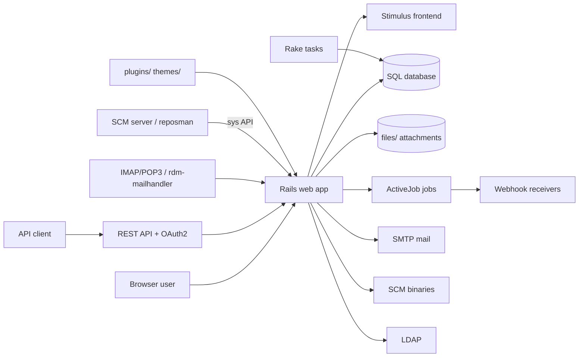

# Architecture

Redmine is one Ruby on Rails 8.1 application. The same process serves the HTML pages and the REST API. Background jobs, Rake tasks and plugins run inside the same code base. There is no separate frontend build: JavaScript is served through importmap and Propshaft.

## Rails web application

- Folders: `app/controllers`, `app/models`, `app/views`, `app/helpers`, `config/routes.rb`, `lib/redmine/`.
- Tech: Rails 8.1.4, ERB views, Puma in development and system tests.
- `lib/redmine/` holds the core library: access control and permissions (`access_control.rb`), the plugin API (`plugin.rb`, `plugin_loader.rb`), wiki formatting (`wiki_formatting/`: Textile and CommonMark), exports (`export/`: CSV and PDF), SCM adapters (`scm/adapters/`), sudo mode, themes.
- `ApplicationController` (`app/controllers/application_controller.rb`) handles session, API key and OAuth2 authentication, and `rescue_from` handlers.
- Health endpoint: `GET /up` (`rails/health#show`, `config/routes.rb`).

## REST API and OAuth2

- Folders: `app/views/**/*.api.rsb` (XML and JSON builders), `config/initializers/doorkeeper.rb`, `app/controllers/oauth2_applications_controller.rb`.
- The API uses the same controllers as the HTML pages. A request is authenticated by API key, HTTP basic auth or an OAuth2 token issued by Doorkeeper. Tables: `oauth_applications`, `oauth_access_grants`, `oauth_access_tokens`, `tokens`.

## Frontend JavaScript and CSS

- Folders: `app/javascript/controllers` (Stimulus controllers: wiki toolbar, gantt, mermaid, clipboard, tablesort, ...), `app/javascript/wiki_formatting`, `app/assets/stylesheets`, `app/assets/images`, `vendor/javascript`, `config/importmap.rb`.
- Tech: Stimulus (`stimulus-rails`), `importmap-rails`, `requestjs-rails`, Propshaft. Stylelint checks the CSS (`.stylelintrc`). SVG icons are built by `lib/tasks/icons.rake`.
- Mermaid.js is not in git: `bin/rails redmine:mermaid:install` downloads it from registry.npmjs.org into `vendor/javascript/mermaid.min.js`.

## Background jobs

- Folder: `app/jobs` (`WebhookJob`, `DestroyProjectJob`, `DestroyProjectsJob`).
- Tech: ActiveJob. Tests use the `:inline` adapter (`config/environments/test.rb`). The repository does not set a production adapter, so Rails uses `:async` (in-process threads). Admin > Information shows a warning in production while the adapter is `:async` (`AdminController#info`). Example override: `config/additional_environment.rb.example`.
- `WebhookJob` sends HTTP requests to the webhook URLs configured in the `webhooks` table (`app/models/webhook.rb`).

## Rake tasks

- Folder: `lib/tasks`. Tasks: reminders (`reminder.rake`), receiving email from IMAP or POP3 (`email.rake`), ciphering of stored passwords (`ciphering.rake`), default data (`load_default_data.rake`), imports from Trac and Mantis, Mermaid install, locales, icons, CI (`ci.rake`) and test repositories (`testing.rake`).
- The harness tasks (`setup`, `dev`, `lint`, `check-fast`, `check`) are in the root `Rakefile`.
- Scheduling (cron for reminders or email fetching) is outside this repository.

## Database

- Folders: `db/migrate` (331 migrations), `config/database.yml.example`. `db/schema.rb` is generated and ignored by git.
- Adapters: MySQL/MariaDB (`mysql2` or `trilogy`), PostgreSQL, SQLite3 and SQL Server. The `Gemfile` reads `config/database.yml` and installs only the adapter gems it names. CI tests PostgreSQL, MySQL and SQLite3 (`.github/workflows/tests.yml`).
- Tables that matter: `projects`, `issues`, `journals`, `journal_details`, `trackers`, `issue_statuses`, `workflows`, `users` (also groups, through `type`), `members`, `member_roles`, `roles`, `versions`, `time_entries`, `custom_fields`, `custom_values`, `enumerations`, `queries`, `wikis`, `wiki_pages`, `wiki_contents`, `repositories`, `changesets`, `changes`, `attachments`, `settings`, `webhooks`.

## File storage

- Folder: `files/` by default (ignored by git). The path can be changed with `attachments_storage_path` in `config/configuration.yml`. Table: `attachments` (`app/models/attachment.rb`). Thumbnails go to `tmp/thumbnails` and need ImageMagick (and Ghostscript for PDF).

## Mail

- Outgoing: `app/models/mailer.rb` (ActionMailer). SMTP or sendmail settings are in `config/configuration.yml` (copy from `config/configuration.yml.example`).
- Incoming: `app/models/mail_handler.rb`, the endpoint `app/controllers/mail_handler_controller.rb`, the script `extra/mail_handler/rdm-mailhandler.rb`, and IMAP/POP3 polling in `lib/redmine/imap.rb`, `lib/redmine/pop3.rb` (called from `lib/tasks/email.rake`).

## SCM repositories

- `app/models/repository/*.rb` and `lib/redmine/scm/adapters/*` call the `svn`, `git`, `hg`, `bzr` and `cvs` command-line tools. The filesystem adapter needs no tool.
- `app/controllers/sys_controller.rb` serves the sys API (`/sys`) used by `extra/svn/reposman.rb`. `extra/svn/Redmine.pm` is a Perl Apache module for repository access control.
- Tables: `repositories`, `changesets`, `changes`, `changesets_issues`.

## LDAP

- `app/models/auth_source_ldap.rb` (`net-ldap` gem, optional `ldap` group in the `Gemfile`). Table: `auth_sources`.

## Plugins and themes

- Folders: `plugins/` and `themes/` (contents ignored by git). `lib/redmine/plugin_loader.rb` loads plugins at boot. The main `Gemfile` evaluates each plugin `Gemfile`. `extra/sample_plugin` is an example plugin. Themes: `lib/redmine/themes.rb`.

## Not visible in this repository

- How and where production runs: see [deploy.md](deploy.md).
- The production job queue, cron jobs, cache store and log collection: see [observability.md](observability.md).
