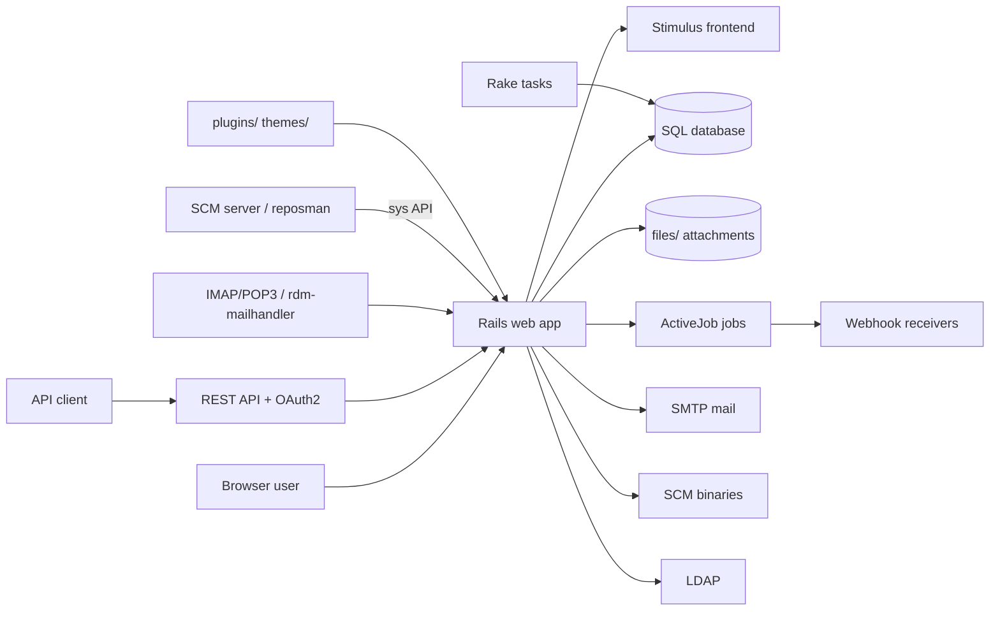

# Harness assessment: Redmine

Written by uw-harness 0.3.0 (spec v4) on 2026-11-01. It records what the repository showed before the harness was built. Do not edit it by hand: run `npx uw-harness analyze --force` to refresh it.

**Score before:** 19/100, level 0.

## The product

Redmine is a flexible, open-source project management web application built with Ruby on Rails.

Redmine gives teams one self-hosted place to manage many projects: issues with configurable trackers and workflows, time tracking, Gantt charts and calendars, wikis, forums, documents, files and source repository browsing. Organizations host it on their own servers, choose their database, add plugins and themes, and integrate it through a REST API, OAuth2, incoming email and webhooks.

**Users:** Project members (developers, reporters) who create and update issues, log time and edit wikis, Project managers who plan versions, Gantt charts and calendars and run reports, Redmine administrators who configure trackers, roles, workflows, custom fields, authentication (LDAP, 2FA) and settings, API clients and integrators using the REST API, OAuth2 applications and webhooks, Mail servers and SCM servers that push email and repository changes into Redmine (rdm-mailhandler, reposman, sys API), Plugin and theme developers extending Redmine

### Use cases

- **Issue tracking.** Create, list, filter, edit and bulk-update issues with trackers, statuses, workflows, custom fields, watchers, relations and journals. Entry points: `app/controllers/issues_controller.rb`, `app/models/issue.rb`, `app/models/issue_query.rb`, `app/controllers/workflows_controller.rb`, `config/routes.rb`.
- **Time tracking.** Log spent time on issues and projects and report on it. Entry points: `app/controllers/timelog_controller.rb`, `app/models/time_entry.rb`, `app/models/time_entry_query.rb`.
- **Planning: Gantt, calendar, versions.** Plan work with versions/roadmaps, Gantt charts (HTML, PDF, PNG export) and calendars. Entry points: `app/controllers/gantts_controller.rb`, `app/controllers/calendars_controller.rb`, `app/controllers/versions_controller.rb`, `lib/redmine/helpers`.
- **Wiki, forums, news, documents and files.** Collaborate with per-project wikis (Textile/CommonMark, Mermaid), message boards, news, documents and file releases. Entry points: `app/controllers/wiki_controller.rb`, `app/controllers/boards_controller.rb`, `app/controllers/messages_controller.rb`, `app/controllers/news_controller.rb`, `app/controllers/documents_controller.rb`, `lib/redmine/wiki_formatting`.
- **Source repository browsing.** Browse Subversion, Git, Mercurial, Bazaar, CVS and filesystem repositories and link changesets to issues. Entry points: `app/controllers/repositories_controller.rb`, `app/models/repository`, `lib/redmine/scm/adapters`, `app/controllers/sys_controller.rb`, `extra/svn/reposman.rb`.
- **Administration and access control.** Manage projects, users, groups, roles, permissions, custom fields, enumerations, authentication sources (LDAP), two-factor auth and global settings. Entry points: `app/controllers/admin_controller.rb`, `app/controllers/projects_controller.rb`, `app/controllers/users_controller.rb`, `app/controllers/roles_controller.rb`, `app/controllers/settings_controller.rb`, `app/controllers/twofa_controller.rb`, `lib/redmine/access_control.rb`.
- **Incoming email.** Create and update issues and messages from emails received through the mail handler endpoint, IMAP or POP3. Entry points: `app/controllers/mail_handler_controller.rb`, `app/models/mail_handler.rb`, `extra/mail_handler/rdm-mailhandler.rb`, `lib/tasks/email.rake`.
- **REST API, OAuth2 and webhooks.** Integrate other systems through XML/JSON API (API key or Doorkeeper OAuth2) and outgoing webhooks delivered by a background job. Entry points: `app/views/**/*.api.rsb`, `app/controllers/oauth2_applications_controller.rb`, `config/initializers/doorkeeper.rb`, `app/controllers/webhooks_controller.rb`, `app/jobs/webhook_job.rb`.
- **Imports and exports.** Import issues, time entries, users and non-working dates from CSV; export to CSV, PDF and Atom. Entry points: `app/controllers/imports_controller.rb`, `app/models/issue_import.rb`, `lib/redmine/export`.
- **Plugins and themes.** Extend Redmine with plugins (plugins/) and themes (themes/) loaded at boot. Entry points: `lib/redmine/plugin.rb`, `lib/redmine/plugin_loader.rb`, `config/initializers/00-core_plugins.rb`, `extra/sample_plugin`, `lib/redmine/themes.rb`.

### Glossary

| Term | Meaning |
| --- | --- |
| Tracker | Issue type (for example Bug, Feature, Support); each tracker has its own workflow and fields (app/models/tracker.rb). |
| Journal / JournalDetail | History entry of an issue or other object: notes and the list of attribute changes (app/models/journal.rb). |
| Workflow | Rules that say which role may move an issue from one status to another and which fields are read-only or required (workflow_transition.rb, workflow_permission.rb). |
| Enumeration | Admin-defined value lists: issue priorities, time entry activities, document categories. |
| Principal | Base class of User and Group (app/models/principal.rb). |
| Member / MemberRole | Membership of a user or group in a project with one or more roles. |
| Version | Project milestone/release used for the roadmap. |
| Changeset | A commit imported from a linked source repository. |
| Query | Saved filter and column configuration for issues, time entries, projects or users (app/models/query.rb). |
| Auth source | External authentication backend, currently LDAP (auth_source_ldap.rb). |
| Sys API | Endpoints under /sys used by SCM servers and reposman.rb to create repositories and fetch changesets. |
| Redmine.pm | Perl Apache module in extra/svn for repository access control against Redmine users. |
| Textile / CommonMark | The two text formatters for wiki and descriptions (lib/redmine/wiki_formatting). |
| Sudo mode | Re-entering the password before sensitive actions (lib/redmine/sudo_mode.rb). |
| Fixtures | YAML test data in test/fixtures loaded by Rails tests. |
| rNNNNN | Subversion revision numbers cited in commit messages; the git repository is a mirror of the official Subversion repository. |
| #NNNNN | Issue number on www.redmine.org, cited at the end of each commit message. |

## Stack

- Languages: Ruby (>= 3.3, < 4.1; CI tests 3.3, 3.4, 4.0), JavaScript (Stimulus controllers via importmap), CSS, Perl (extra/svn/Redmine.pm)
- Frameworks: Rails 8.1.4, Hotwire Stimulus (stimulus-rails) with importmap-rails, Propshaft asset pipeline, Doorkeeper (OAuth2 provider), Minitest with mocha, Capybara + Selenium (system tests), RuboCop (+performance, +rails), Stylelint, Puma (server in tests and install docs)
- Data stores: Relational database chosen in config/database.yml: MySQL/MariaDB (mysql2 or trilogy), PostgreSQL, SQLite3 or SQL Server, Local filesystem for attachments (files/), In-memory cache stores (redmine_search_cache_store = :memory_store)
- External services: SMTP/sendmail for outgoing email (configured in config/configuration.yml), IMAP/POP3 mailboxes for incoming email (lib/redmine/imap.rb, pop3.rb), LDAP directories (optional, net-ldap), SCM binaries: svn, git, hg, bzr, cvs, ImageMagick, Ghostscript, Pandoc (optional, thumbnails and previews), Gravatar (avatars), registry.npmjs.org for redmine:mermaid:install, Webhook receivers (outgoing HTTP from WebhookJob)

## Architecture

| Component | Kind | Path | Tech | What it does |
| --- | --- | --- | --- | --- |
| Rails web application | web app | `app/, config/, lib/redmine/` | Ruby on Rails 8.1, ERB views | Controllers, models and views for projects, issues, wiki, time tracking, admin. Routes in config/routes.rb. Core library code (access control, SCM adapters, export, wiki formatting, plugin API) in lib/redmine. |
| REST API and OAuth2 | API | `app/views/**/*.api.rsb, config/initializers/doorkeeper.rb` | Rails, Doorkeeper | XML/JSON API served by the same controllers; authentication by API key, basic auth or OAuth2 tokens. |
| Frontend JavaScript | frontend | `app/javascript, app/assets, vendor/javascript` | Stimulus, importmap, Propshaft, CSS | Stimulus controllers (wiki toolbar, gantt, mermaid, clipboard, tablesort) and stylesheets; Mermaid.js is optionally installed into vendor/javascript. |
| Background jobs | worker | `app/jobs` | ActiveJob | WebhookJob, DestroyProjectJob, DestroyProjectsJob. Queue adapter is :inline in tests; production adapter is not configured in the repository (Rails default). |
| Rake tasks / CLI | scheduler | `lib/tasks` | Rake | Reminders, email receiving (IMAP/POP3), ciphering, default data loading, migration from Trac/Mantis, Mermaid install, CI tasks. Scheduling (cron) is outside the repository. |
| Database | database | `db/migrate, config/database.yml.example` | MySQL / PostgreSQL / SQLite3 / SQL Server | 331 migrations; adapter gems are selected in the Gemfile from config/database.yml. |
| File storage | datastore | `files/` | local filesystem | Attachment storage. |
| Mail | external service | `app/models/mailer.rb, app/models/mail_handler.rb, extra/mail_handler` | ActionMailer, net-smtp, net-imap, net-pop | Outgoing notifications and incoming email handling. |
| SCM repositories | external service | `lib/redmine/scm/adapters, app/models/repository, extra/svn` | svn, git, hg, bzr, cvs binaries | Repository browsing via command-line SCM tools; sys API and reposman/Redmine.pm for server integration. |
| LDAP | external service | `app/models/auth_source_ldap.rb` | net-ldap | Optional external authentication. |
| Plugins and themes | extension | `plugins/, themes/, lib/redmine/plugin.rb` | Ruby | Third-party extensions loaded at boot; plugin Gemfiles are evaluated by the main Gemfile. |

## Workflows found in the repository

- setup: `bundle install`
- run local: `bin/rails server`
- test: `bin/rails test`
- lint: `bundle exec rubocop --parallel`
- build: not found
- deploy: not found

## Requirements

### ✗ An AGENTS.md at the root

`agents-file`, level 1. Check: no AGENTS.md.

**Gap.** There is no agent entry file.

**Plan.** Create AGENTS.md (under 150 lines): what Redmine is, commands (cp config/database.yml.example setup for SQLite test, bundle install, bin/rails server, rake check_fast, rake check), layout (app/, lib/redmine, config/, db/migrate, test/{unit,functional,integration,system}, plugins/, themes/, extra/), conventions (RuboCop, commit message style with #issue, no PRs on GitHub upstream), verification, never-do list, links to docs/. Create CLAUDE.md containing only `@AGENTS.md`.

Reference: https://docs.unwritten.sh/harness/requirements/agents-file/

### ✗ AGENTS.md matches the repository

`agents-file-accurate`, level 1. Check: no AGENTS.md to check.

**Gap.** No AGENTS.md exists.

**Plan.** Only reference rake tasks that exist (add the new check_fast/check tasks in lib/tasks in the same change) and relative links to files that exist (doc/RUNNING_TESTS, doc/INSTALL, docs/*.md). Run `npx -y uw-harness check`.

Reference: https://docs.unwritten.sh/harness/requirements/agents-file-accurate/

### ✗ An architecture overview with a diagram

`architecture`, level 1. Check: no docs/architecture.md.

**Gap.** No architecture overview or diagram.

**Plan.** Create docs/architecture.md with the Mermaid flowchart from this assessment and one section per component (web app, API/OAuth2, Stimulus frontend, ActiveJob jobs, rake tasks, database with key tables issues/journals/projects/users/members/time_entries/wiki_pages/changesets, file storage, mail, SCM adapters, LDAP, plugins). State that production queue adapter, cron and cache store are not configured in the repository.

Reference: https://docs.unwritten.sh/harness/requirements/architecture/

### ✗ What the product does and for whom

`product`, level 1. Check: no README.

**Gap.** No product description with users, use cases and glossary.

**Plan.** Create docs/product.md with the value proposition, roles, the 10 use cases with entry points and the glossary from this assessment.

Reference: https://docs.unwritten.sh/harness/requirements/product/

### ✗ Architecture decision records

`decisions`, level 2. Check: no docs/decisions/.

**Gap.** No architecture decision records.

**Plan.** Create docs/decisions/0001-record-architecture-decisions.md (format) and 0002-multi-database-support-via-database-yml.md (inferred: the Gemfile loads adapter gems from config/database.yml; CI tests PostgreSQL, MySQL and SQLite3). Optionally 0003-importmap-stimulus-no-js-build.md. Mark them as inferred.

Reference: https://docs.unwritten.sh/harness/requirements/decisions/

### ✗ An implementation log

`implementation-log`, level 2. Check: no docs/harness/log.md.

**Gap.** No implementation log.

**Plan.** Let uw-harness write docs/harness/log.md; add an AGENTS.md rule to append one dated entry per significant change. Keep doc/CHANGELOG untouched (upstream release notes).

Reference: https://docs.unwritten.sh/harness/requirements/implementation-log/

### ✓ Team agreements

`agreements`, level 1. Check: CONTRIBUTING.md exists.

### ✓ One entry point for tasks

`task-runner`, level 1. Check: Rakefile: 1 tasks.

### ✗ A fast gate

`fast-gate`, level 2. Check: no fast gate target (for example check-fast).

**Gap.** No single fast command that lints and runs unit tests.

**Plan.** Add lib/tasks/harness.rake with `task check_fast` (alias `check:fast`) that runs `rubocop --parallel` and `bin/rails test test/unit test/helpers` (RAILS_ENV=test, SQLite3, PARALLEL_WORKERS). Requires config/database.yml for test with sqlite3; have the setup task create it from a template if missing. Run it with `bundle exec rake check_fast`.

Reference: https://docs.unwritten.sh/harness/requirements/fast-gate/

### ✗ A full gate

`full-gate`, level 2. Check: no full gate target (for example check).

**Gap.** No single command reproduces what CI runs.

**Plan.** Add `task check` in lib/tasks/harness.rake: rubocop, `npx stylelint "app/assets/stylesheets/**/*.css"`, `bin/rails test`, `bin/rails test:autoload`, and optionally test:system when Chrome is available. Keep bundle audit out or optional (needs network).

Reference: https://docs.unwritten.sh/harness/requirements/full-gate/

### ✓ Automated tests

`tests`, level 1. Check: 404 test files (ignored: 13 without any test, 6 with only trivial assertions).

### ◐ CI runs the gate on every change

`ci`, level 2. Check: .github/workflows/linters.yml, .github/workflows/tests.yml exist but do not call the task runner.

**Gap.** CI does not call the task runner or uw-harness verify; the GitHub repo is a mirror and upstream does not review PRs there.

**Plan.** Add .github/workflows/harness.yml on pull_request and push that sets up Ruby 3.3, Node 20, writes a sqlite3 config/database.yml, runs bundle install and `npx -y uw-harness verify` (or `bundle exec rake check`). Do not modify the existing tests.yml and linters.yml.

Reference: https://docs.unwritten.sh/harness/requirements/ci/

### ✗ Git hooks run the fast gate

`hooks`, level 3. Check: no git hooks configuration.

**Gap.** No git hook runs the fast gate.

**Plan.** Add .githooks/pre-push running `bundle exec rake check_fast`, and a `setup` rake task that runs `git config core.hooksPath .githooks`.

Reference: https://docs.unwritten.sh/harness/requirements/hooks/

### ✗ The app runs locally with one command

`local-env`, level 1. Check: no compose file, devcontainer or dev target.

**Gap.** No one-command local environment and no dev task.

**Plan.** Add compose.yaml with optional postgres:14 and mysql:8.4 services (same as CI), a config/database.yml template for SQLite development/test, rake tasks `setup` (copy database.yml if missing, bundle install, db:create db:migrate, redmine:load_default_data REDMINE_LANG=en, test:scm:setup:all, install hooks) and `dev` (bin/rails server). Document in docs/local-dev.md.

Reference: https://docs.unwritten.sh/harness/requirements/local-env/

### ✗ Configuration is documented, no secret in git

`env-example`, level 1. Check: no .env.example.

**Gap.** No .env.example; configuration is YAML-based, not environment variables.

**Plan.** Create .env.example listing the environment variables the code and tests read (RAILS_ENV, PARALLEL_WORKERS, SCMS, REDMINE_TEST_LDAP_SERVER, GOOGLE_CHROME_OPTS_ARGS, CAPYBARA_SERVER_HOST/PORT, SELENIUM_REMOTE_URL, RAILS_RELATIVE_URL_ROOT, REDMINE_LANG) with safe values, and point to the *.yml.example files for the rest. Note that the test secret_key_base is intentional test data.

Reference: https://docs.unwritten.sh/harness/requirements/env-example/

### ✗ Toolchain versions are pinned

`toolchain-pinned`, level 1. Check: no runtime version file.

**Gap.** The Gemfile states a Ruby range but the checker does not recognize it; no version file.

**Plan.** Add .tool-versions with `ruby 3.3.x` and `nodejs 20` (lowest CI versions), or .ruby-version plus .nvmrc. Check the .gitignore first so the file is not ignored.

Reference: https://docs.unwritten.sh/harness/requirements/toolchain-pinned/

### ✗ Deployment is explicit in the repository

`deploy-explicit`, level 3. Check: nothing in the repository says how it is deployed.

**Gap.** Redmine is a product that users self-host; how this particular copy is deployed (if at all) is not visible in the repository.

**Plan.** Create docs/deploy.md summarizing doc/INSTALL and doc/UPGRADING (bundle install --without development test, db:migrate, assets:precompile, generate_secret_token, file permissions, Puma) with a uw-harness TODO block for environments, who deploys and rollback, until a human answers.

Reference: https://docs.unwritten.sh/harness/requirements/deploy-explicit/

### ✗ Production can be observed

`observability`, level 3. Check: no docs/observability.md.

**Gap.** No document on logs, metrics, alerts or health checks.

**Plan.** Create docs/observability.md: Rails logger and log/ folder, log level, Admin > Information as a health view, no health endpoint or error tracker in the code, plus a TODO block for where production logs, dashboards and alerts live.

Reference: https://docs.unwritten.sh/harness/requirements/observability/

### ✗ Skills for repeated tasks

`skills`, level 2. Check: no skills in .agents/skills/ or .claude/skills/.

**Gap.** No skills.

**Plan.** Create .agents/skills/{implement-change,debug-local,write-migration,frontend-stimulus}/SKILL.md (implement-change uses rake check_fast/check; debug-local uses `debug` gem, log/development.log, bin/rails console, fixtures; write-migration covers db/migrate across MySQL/PostgreSQL/SQLite; frontend skill covers Stimulus controllers, importmap, stylelint, svg icons). Symlink .claude/skills to .agents/skills.

Reference: https://docs.unwritten.sh/harness/requirements/skills/

## Questions for a human

- (`deploy-explicit`) Is this copy of Redmine deployed anywhere by your team (which server, which environments), or is it only a mirror of upstream used for development? The repository is the upstream product with only install docs; no deployment artifact is present.
- (`deploy-explicit`) If it is deployed: who can deploy, how is a release built (git tag, tarball), and how do you roll back database migrations? Needed for docs/deploy.md and a deploy skill; nothing in the repository shows it.
- (`observability`) Where do production logs go (log/production.log, STDOUT to a collector?), and is there any error tracker, dashboard or alert channel? The code has only the Rails logger; no Sentry or metrics.
- (`ci`) May we add a new GitHub Actions workflow on pull_request in this repository, given upstream development happens on redmine.org Subversion and GitHub PRs are not reviewed? Decides whether the harness CI is useful here and whether workflows run at all.
- (`local-env`) Which database should be the default for local development and the fast gate: SQLite3 (simplest) or PostgreSQL/MySQL in Docker? config/database.yml is required before bundle install and decides which adapter gems are installed.
- (`agreements`) Should changes from agents follow the upstream process (patch attached to an issue on redmine.org, commit message ending with (#issue)) or a local branch and pull request process? CONTRIBUTING.md points to redmine.org; the definition of done for this fork is not written.
- (`fast-gate`) Is it acceptable that the fast gate skips SCM, LDAP and system (Chrome) tests that need external binaries or services? Many tests depend on svn/hg/bzr/cvs binaries, LDAP and Chrome; they are skipped or fail without them.

## Risks

- The Gemfile reads config/database.yml (git-ignored) to choose database gems: without that file, bundle install warns and no database adapter is installed, so setup and every gate fail.
- Full test suite is large (about 400 test files) and slow; running it in a fast gate will exceed one minute. Use unit + helpers only for check_fast.
- Many tests need external binaries (svn, git, hg, bzr, cvs, ImageMagick, Ghostscript, Pandoc) or services (LDAP, Chrome for system tests); results vary by machine and some are silently skipped.
- The git repository is a mirror of the upstream Subversion repository (commit messages cite rNNNNN; svn:ignore commits). Harness files added here may conflict with upstream syncs and are not accepted upstream.
- Existing CI runs only on push and does not call a task runner; editing tests.yml or linters.yml could diverge from upstream.
- config/environments/test.rb contains a hard-coded secret_key_base for tests; a secret scanner may flag it although it is test-only.
- bundle-audit and redmine:mermaid:install need network access; do not put them in the fast gate.
- Ruby 4.0 is in the CI matrix; local Ruby must be 3.3 to 4.0, older Rubies will not install.
- Plugins in plugins/ have their Gemfiles evaluated and are loaded at boot; a local plugin can break the gates.
